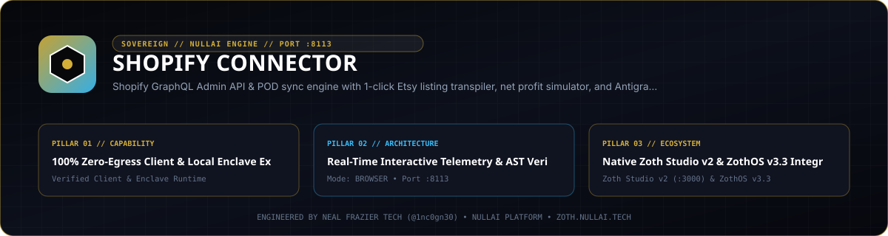

<p align="center">
  
</p>

# Shopify Connector

**Zero-dependency Python 3.10+ Shopify GraphQL Admin API client, Etsy-to-Shopify `productCreate` transpiler, SEO rank auditor, plan-tier processing fee calculator, loopback HTTP deck, and 7-tool MCP server.**

- **Zoth Studio v2 Dossier**: [https://zoth.nullai.tech/tools/shopify-connector](https://zoth.nullai.tech/tools/shopify-connector)
- **Default Loopback Endpoint**: `http://127.0.0.1:8113`
- **Runtime Dependencies**: Zero external Python runtime packages (100% Python `stdlib`)
- **License**: MIT (100% free and open-source)

---

## Overview

`shopify-connector` provides local-first Shopify catalog auditing, multi-channel listing transpilation, and GraphQL Admin API integration with deterministic offline simulation when store credentials are not configured:

- **Etsy-to-Shopify GraphQL Transpiler**: Converts Etsy titles, 13-tag arrays, descriptions, and retail prices into validated Shopify GraphQL `productCreate` mutations with URL handles and SEO metafields.
- **Shopify SEO & Listing Auditor**: Scores product titles, handles, tag coverage, and description word counts on a `0-100` rubric (`A+` through `D`) with explicit deduction breakdowns.
- **Plan-Tier Margin Calculator**: Computes payment gateway fees across `basic` (`2.9% + $0.30`), `shopify` (`2.6% + $0.30`), and `advanced` (`2.4% + $0.30`) plans alongside POD production costs and optional `15%` ad CAC buffers.
- **7-Tool MCP Server**: Exposes stdio JSON-RPC 2.0 tools for AI agents alongside a loopback HTTP workstation on `127.0.0.1:8113`.

---

## Architecture

```text
src/shopify_connector/
├── client.py       # Stdlib Shopify GraphQL Admin API client & offline catalog simulator
├── transpiler.py   # Etsy listing -> Shopify GraphQL `productCreate` mutation builder
├── seo_engine.py   # Product SEO scorer & Basic/Shopify/Advanced fee/margin calculator
├── mcp_server.py   # JSON-RPC 2.0 stdio MCP server exposing 7 Shopify & POD tools
├── server.py       # Loopback HTTP API, SSE stream & browser deck (127.0.0.1:8113)
└── cli.py          # Unified CLI entrypoint (`shopify-connector`)
```

---

## Quickstart

```bash
git clone https://github.com/1nc0gn30/shopify-connector.git
cd shopify-connector
python3 -m pip install -e .

# Launch the loopback web workstation on http://127.0.0.1:8113
python3 server.py --host 127.0.0.1 --port 8113
```

Or run via the CLI entrypoint:

```bash
shopify-connector serve --host 127.0.0.1 --port 8113
```

---

## CLI & MCP Usage

### CLI Subcommands

```bash
# View CLI help or check daemon/store status
shopify-connector --help
shopify-connector status --json

# Audit a Shopify product title, handle, tags, and description
shopify-connector audit \
  --title "Heavyweight Organic Cotton Botanical Crewneck Sweatshirt" \
  --handle "botanical-crewneck-sweatshirt" \
  --tags "botanical,crewneck,organic cotton,apparel" \
  --desc "Garment-dyed heavyweight fleece printed at 300 DPI." \
  --json

# Calculate Shopify processing fees and net margin across plan tiers
shopify-connector profit --retail 38.99 --pod 14.50 --plan basic --ads --json

# Transpile an Etsy listing into a Shopify GraphQL productCreate payload
shopify-connector transpile \
  --title "Wildflower Embroidered Sweatshirt" \
  --tags "wildflower,sweatshirt,gift" \
  --price 36.99 \
  --json

# Search catalog products
shopify-connector search --query "sweatshirt" --limit 5 --json

# Launch the stdio MCP server
shopify-connector mcp
```

### ZothOS v3.4.0 CLI Integration

On ZothOS v3.4.0 workstations, `shopify-connector` and `shopify-connector-tui` are installed in `/usr/local/bin/`:

```bash
shopify-connector --json
shopify-connector-tui --json
shopify-connector serve --port 8113
```

### Model Context Protocol (MCP) Tools

```json
{
  "mcpServers": {
    "shopify-connector": {
      "command": "shopify-connector",
      "args": ["mcp"]
    }
  }
}
```

| MCP Tool | Description |
| :--- | :--- |
| `shopify_search_products` | Search active or draft products in the catalog by title, tag, or vendor |
| `shopify_audit_listing` | Score product SEO (`0-100`) across title length, handle, tags, and copy |
| `shopify_calculate_margins` | Compute plan-specific processing fees, POD cost, ad CAC, and net margin |
| `shopify_transpile_etsy` | Convert an Etsy POD listing into a Shopify GraphQL `productCreate` payload |
| `shopify_create_draft_product` | Create a draft Shopify product with variants, tags, and SEO metafields |
| `shopify_get_shop_info` | Retrieve connected shop domain, plan tier, currency, and catalog count |
| `shopify_inventory_check` | Inspect fulfillment warehouse locations and inventory status |

---

## HTTP API Reference

When running on `http://127.0.0.1:8113`:

| Method | Endpoint | Description |
| :--- | :--- | :--- |
| `GET` | `/health`, `/api/health` | Service health status, port, mode, and uptime |
| `GET` | `/api/info`, `/api/stats` | Connected shop metadata and audit/transpile counters |
| `GET` | `/api/products`, `/api/export` | Product catalog query and CSV/JSON catalog export |
| `GET` | `/api/stream`, `/api/events` | Server-Sent Events (SSE) live telemetry stream |
| `POST` | `/api/audit` | Run Shopify product SEO audit |
| `POST` | `/api/profit` | Calculate Shopify plan fees and POD net profit margin |
| `POST` | `/api/transpile` | Transpile Etsy listing data into Shopify GraphQL mutation |
| `POST` | `/api/create-draft` | Create a draft product in Shopify (or offline simulator) |

---

## Testing & Verification

```bash
# Run the pytest suite
PYTHONPATH=src python3 -m pytest -q

# Scan repository with gitleaks
gitleaks detect --source . --no-banner --redact
```

---

## Support

Shopify Connector is 100% free and open-source software. Optional community support is available via [Buy Us a Coffee (Stripe)](https://buy.stripe.com/3cIfZg27PdKo2D64Ocfw40X).

## License

MIT License — Copyright (c) 2026 [1nc0gn30](https://1nc0gn30.si) (`@1nc0gn30`) & [NullAI](https://nullai.tech). See [LICENSE](LICENSE) for full text.
