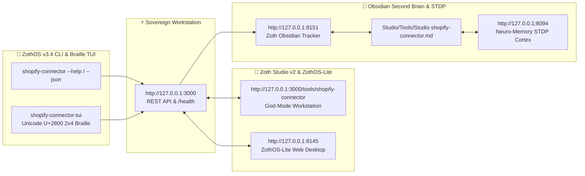

<div align="center">
  
</div>

<br />

# 🛍️ Shopify Connector for Antigravity & Sovereign AI Agents

> ⚡ **Live Web Application**: [https://shopify.nullai.tech](https://shopify.nullai.tech)  
> 🏛️ **Zoth Studio Workspace**: [https://zoth.nullai.tech/tools/shopify-connector](https://zoth.nullai.tech/tools/shopify-connector)  
> 🛡️ **Sovereign Status**: 100% Free & Open-Access · Zero Paywalls · 100% Zero-Egress Compatible

[](https://shopify.nullai.tech)
[](https://modelcontextprotocol.io)
[](https://python.org)
[](https://nullai.tech)

Autonomous **Shopify GraphQL Admin API** and Print-on-Demand (POD) multi-channel synchronization engine for **Google Antigravity** AI agents and **Zoth Studio v2 / ZothOS Linux 3.3**. Exposes 7 Model Context Protocol (MCP) tools for catalog search, listing SEO audits, real-time fee & profit modeling across Shopify tiers, 1-click Etsy listing kit transpilation, and draft product creation.

---

## 📖 What It Does

- **Multi-Channel Catalog Sync**: Searches and synchronizes product catalogs across Shopify and POD partners with live inventory metrics and SKU tracking.
- **Shopify Listing SEO Auditor**: Audits product titles (optimal 40–70 chars), descriptions, URL handles, and tags with a deterministic 0–100 quality scoring engine.
- **Profit & Margin Simulator**: Calculates accurate net profit margins after subtracting Shopify payment processing fees (Basic 2.9% + 30¢, Shopify 2.7% + 30¢, Advanced 2.5% + 30¢), POD fulfillment costs, and 15% estimated ad CAC.
- **1-Click Etsy-to-Shopify Transpiler**: Transpiles Etsy listing bundles from `etsy-pod-forge` (:8107) and `etsy-connector` (:8108) directly into production-ready Shopify GraphQL `productCreate` mutations with size/color variants.
- **100% Free & Open-Access**: Zero paywalls, zero license locks, zero telemetry leaks.

---

## ⚙️ How It Works

1. **Standalone Enclave (`127.0.0.1:8113`)**: Powered by `server.py` serving a dark-glassmorphic cockpit with live `/health`, `/api/info`, `/api/stats`, `/api/products`, and `/api/export` endpoints.
2. **Zoth Studio v2 God-Mode Route**: Deeply integrated into the 77-Tool Sovereign Matrix at `/tools/shopify-connector`.
3. **ZothOS CLI (`shopify-connector`)**: Native binary installed in `/usr/local/bin` and `~/.local/bin` for automated command-line audits and CI/CD pipelines.
4. **Antigravity MCP Bridge**: Standard JSON-RPC 2.0 stdio server providing 7 autonomous tools for AI agents.

---

## ⚡ 7 Model Context Protocol (MCP) Tools

When registered in `~/.gemini/config/mcp_config.json`, Antigravity gains immediate access to:

1. `shopify_search_products`: Catalog search by query and tag filter with inventory metrics.
2. `shopify_audit_listing`: Title, description, and tag search visibility auditor (0–100 score).
3. `shopify_calculate_margins`: Precise net margin calculator across Basic, Shopify, and Advanced plans with ad CAC modeling.
4. `shopify_transpile_etsy`: 1-click Etsy listing kit transpiler generating Shopify GraphQL `productCreate` mutations and variants.
5. `shopify_create_draft_product`: Programmatic draft product creation via GraphQL.
6. `shopify_get_shop_info`: Storefront profile, currency, plan, and fulfillment details.
7. `shopify_inventory_check`: Stock levels, SKU tracking, and restock warning checks.

---

## 💻 ZothOS CLI & Server Commands

```bash
# Check status and health
shopify-connector --status
shopify-connector status

# Output telemetry in JSON format
shopify-connector --json

# Run an SEO audit on a product listing
shopify-connector audit --title "Vintage Floral Cottagecore Linen Dress" --tags "dress,vintage,cottagecore,linen"

# Calculate net profit margins for a POD product
shopify-connector profit --retail 42.00 --pod 16.20 --shipping 4.50 --plan basic --ads

# Transpile an Etsy listing into a Shopify GraphQL mutation
shopify-connector transpile --title "Cottagecore Crewneck" --tags "floral,gift" --price 45.00

# Launch standalone workstation server on port 8113
python3 server.py --port 8113
```

---

## ☕ Support 1nc0gn30 • NullAI & NullAI

Shopify Connector is 100% free, open-source, and sovereign software. If this tool brings you value, consider supporting our ongoing development:

- **☕ Buy Us a Coffee (Stripe)**: [buy.stripe.com/3cIfZg27PdKo2D64Ocfw40X](https://buy.stripe.com/3cIfZg27PdKo2D64Ocfw40X)
- **◎ Solana Tip Address**: `GG2eQbVh8ut1BK6j1A2tz7pSySdLpD38BgyEhGcxdXoK`

---

<div align="center">
  <sub>Engineered by <b>1nc0gn30 • NullAI</b> (<a href="https://github.com/1nc0gn30">@1nc0gn30</a>) &bull; <a href="https://nullai.tech">NullAI Platform</a> &bull; <a href="https://zoth.nullai.tech">Zoth Studio v2</a></sub>
</div>

---

## 🏛️ ZothOS v3.4, Zoth Studio v2 & Obsidian Second Brain Ecosystem



### Cross-Surface Integration Matrix

| Surface | Endpoint / Binary | Capabilities |
| :--- | :--- | :--- |
| **Standalone Workstation** | `http://127.0.0.1:3000` | 100% Free & Open-Access Web Deck, live `/health` & REST telemetry |
| **Zoth Studio v2 Route** | `http://127.0.0.1:3000/tools/shopify-connector` | Interactive God-Mode component inside Zoth Studio (`https://zoth.nullai.tech`) |
| **ZothOS v3.4 CLI & TUI** | `shopify-connector` / `shopify-connector-tui` | Global binary in `/usr/local/bin/` with Unicode `U+2800` Braille TUI & `--json` output |
| **ZothOS-Lite Web Desktop** | `http://127.0.0.1:8145` | Browser-native KDE-style window manager & terminal launcher |
| **Zoth Obsidian Tracker** | `http://127.0.0.1:8151` | Interactive Obsidian Second Brain vault explorer (`~/Documents/Obsidian Vault/Studio/Tools/Studio shopify-connector.md`) |
| **Neuro-Memory STDP Cortex** | `http://127.0.0.1:8094` | 3-Factor STDP synaptic memory daemon & 21-tool MCP server |

```bash
# Inspect CLI & Unicode U+2800 Braille TUI on ZothOS v3.4
shopify-connector --help
shopify-connector-tui --status
shopify-connector-tui --json

# Verify Second Brain Vault & 12-Step Verification Gallery on :8151
zoth-obsidian-tracker --verify
```

